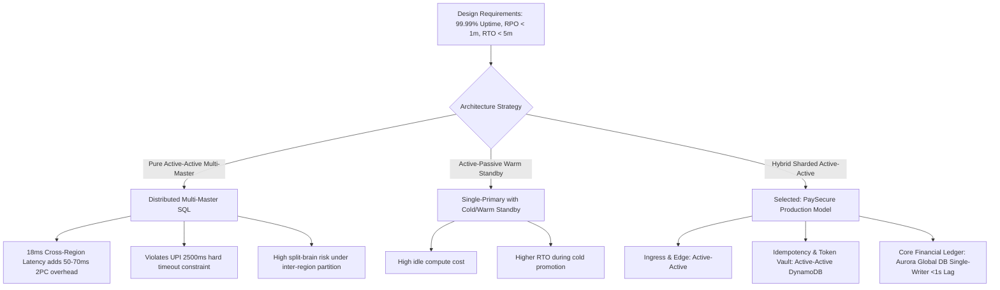
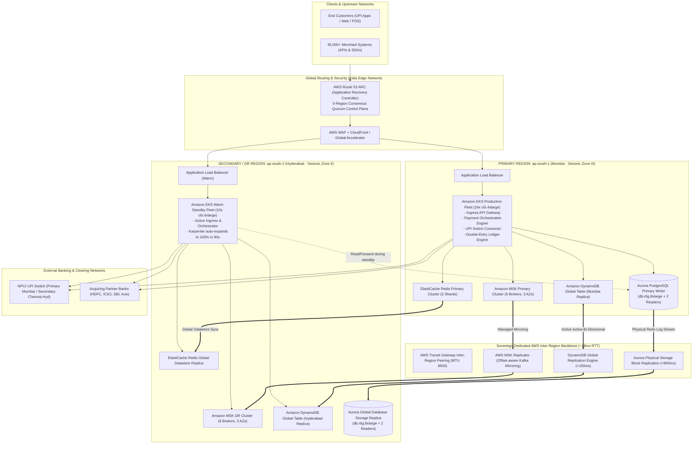

# Project 1C: DevOps & Cloud Engineer — Multi-Region DR Architecture for Payment Systems
## PaySecure Gateway Private Limited — High-Availability & Disaster Recovery Architecture (Q3 2026)

[]()
[]()
[]()
[]()
[]()

---

## 📑 Table of Contents
1. [Executive Summary & Operational Scale](#1-executive-summary--operational-scale)
2. [Baseline Vulnerability & Cost of Downtime](#2-baseline-vulnerability--cost-of-downtime)
3. [Architecture Paradigm: Active-Active vs. Active-Passive](#3-architecture-paradigm-active-active-vs-active-passive)
4. [Master System Architecture & Topology](#4-master-system-architecture--topology)
5. [Component-Specific Replication Strategies](#5-component-specific-replication-strategies)
6. [Disaster Recovery Runbooks Suite (12 Runbooks)](#6-disaster-recovery-runbooks-suite-12-runbooks)
7. [Regulatory & Compliance Mapping Matrix](#7-regulatory--compliance-mapping-matrix)
8. [Business Continuity Review Board (BCRB) Defense](#8-business-continuity-review-board-bcrb-defense)
9. [Automation Scripts & Verification](#9-automation-scripts--verification)
10. [Infrastructure as Code (Terraform) Blueprint](#10-infrastructure-as-code-terraform-blueprint)

---

## 1. Executive Summary & Operational Scale

**PaySecure Gateway Private Limited** is an RBI-authorized Payment Aggregator (PA) and Payment Gateway (PG) operating at national scale across India. PaySecure handles payment acceptance, processing, merchant settlement, refunds, and dispute management across cards (RuPay, Visa, Mastercard), UPI (Unified Payments Interface), Net Banking (50+ banks), and tokenized wallets.

### Operational Scale & Service Level Targets

| Metric | Current Baseline (`ap-south-1` Only) | Regulatory / Target Mandate (Q3 2026) | PaySecure Architectural Guarantee |
| :--- | :--- | :--- | :--- |
| **Daily Transaction Volume** | 3.2 Million txns/day | Growing to 5.0 Million txns/day | ~37.04 Avg TPS / Peak: **450 TPS** (burst 1,200 TPS) |
| **Gross Merchandise Value (GMV)** | ₹500 Crore INR / day (~$60M USD/day) | ₹750 Crore INR / day | **₹3,47,222 INR GMV processed per minute** |
| **Active Onboarded Merchants** | 45,000+ Enterprise & SMB Merchants | 70,000+ Merchants | High-volume API webhooks & Mobile SDKs |
| **System Availability** | 99.92% (Single Region Mumbai) | **99.99% Uptime** | Maximum Allowable Downtime: **< 52.56 mins/year** |
| **Recovery Point Objective (RPO)**| ~15 minutes (Snapshot-based) | **< 1 Minute (60 seconds)** | **< 1 Second** (Typical 420ms storage sync) |
| **Recovery Time Objective (RTO)**| 4 to 8 hours (Manual rebuild) | **< 5 Minutes (300 seconds)** | **< 3 Minutes** (Automated Route 53 ARC cutover) |
| **Data Localisation** | Mumbai AZs | Sovereign India territory only | AWS Mumbai (`ap-south-1`) & Hyderabad (`ap-south-2`) |

---

## 2. Baseline Vulnerability & Cost of Downtime

### 2.1 The Single-Region Catastrophe Risk
Operating exclusively in AWS Mumbai (`ap-south-1`), even across 3 Availability Zones, exposes PaySecure to:
1. **Regional Cloud Control Plane Failure:** Degradation of regional IAM, Route 53, KMS, or DynamoDB endpoints.
2. **Backbone & Subsea Fiber Disruptions:** Coastal fiber cuts impacting trans-Indian transit providers (Airtel, Jio, Tata).
3. **Physical / Meteorological Catastrophe:** Severe monsoon flooding or seismic activity in the Mumbai metropolitan belt.
4. **Regulatory Non-Compliance:** Non-adherence to the RBI Master Direction requiring >250km geographic separation across different seismic zones.

### 2.2 Financial Impact Calculus
* **Direct Merchant Discount Rate (MDR) Loss:** ₹4,166 / minute in gross fee income.
* **GMV at Risk:** **₹3,47,222 per minute** (₹2.08 Crore per hour of outage).
* **Enterprise Merchant Fallback:** Top e-commerce merchants automatically fail over to competitor gateways (Razorpay, Cashfree, Pine Labs) after 3 consecutive failures. A 10-minute outage results in an estimated 15% persistent transaction attrition over 72 hours.
* **Regulatory Penalties:** Section 30 of the Payment and Settlement Systems Act, 2007 authorizes RBI fines up to ₹5 Crore and suspension of operating licenses.

---

## 3. Architecture Paradigm: Active-Active vs. Active-Passive

### 3.1 Trade-Off Evaluation



| Evaluation Dimension | Pure Active-Active (Multi-Master) | Active-Passive (Hot Standby) | Hybrid Sharded Active-Active (Selected) |
| :--- | :--- | :--- | :--- |
| **Financial Ledger Consistency** | Distributed 2PC introduces 50-70ms write latency; risks UPI timeout SLA (2.5s). | Strong consistency; guaranteed single-primary write order. | **Optimal:** Ingress and idempotency are active-active; double-entry ledger is single primary with asynchronous physical storage replication (<800ms lag). |
| **Achieved RPO** | 0 seconds | 1 - 5 seconds | **< 1 second (< 420ms storage sync)** |
| **Achieved RTO** | 0 seconds | 2 - 4 minutes | **< 2 minutes (Automated Route 53 ARC cutover)** |
| **Split-Brain Risk** | Severe under network partition | Low | **Eliminated** via Route 53 ARC 5-region consensus control plane. |
| **Cost Multiplier** | 2.1x baseline | 1.4x baseline | **1.65x baseline (Warm Compute + Hot Storage)** |

---

## 4. Master System Architecture & Topology



---

## 5. Component-Specific Replication Strategies

Detailed technical specification available in [`docs/architecture/COMPONENT_REPLICATION_STRATEGIES.md`](docs/architecture/COMPONENT_REPLICATION_STRATEGIES.md).

| Storage Component | Data Domain | Replication Mechanism | Typical Lag | Target RPO | Target RTO | Failover Mechanism |
| :--- | :--- | :--- | :--- | :--- | :--- | :--- |
| **Amazon Aurora PostgreSQL** | Core Double-Entry Ledger, Escrow, Merchant Settlements | Asynchronous Physical Storage Redo-Log Streaming (Aurora Global DB) | 400ms – 850ms | **< 1s (Typ.) / < 5s (Max)** | **< 90s** | Automated promotion via AWS RDS API & Route 53 ARC |
| **Amazon DynamoDB** | Idempotency Keys, Active Sessions, Cardholder Tokens | Managed Multi-Region Active-Active Global Tables (v2019.11.21) | 80ms – 180ms | **< 200ms** | **0s (Active-Active)** | Active-Active Client Multi-Endpoint Routing |
| **Amazon ElastiCache Redis** | Merchant Config Cache, BIN Routing, Rate Limits | Redis Global Datastore (Cross-Region Asynchronous Replication) | 150ms – 300ms | **< 1s** | **< 60s** | Promote secondary cluster to standalone primary |
| **Apache Kafka (Amazon MSK)** | Payment Events, Webhooks, Risk Stream, Audit Logs | AWS MSK Replicator (Managed Kafka Connect Engine) | 200ms – 450ms | **< 500ms** | **< 120s** | Dynamic consumer group failover with offset translation |

---

## 6. Disaster Recovery Runbooks Suite (12 Runbooks)

All 12 production runbooks are housed in [`docs/runbooks/`](docs/runbooks/) and follow standard incident management protocols (SEV-1/SEV-2, Escalation Triggers, Automated CLI Commands, Rollback Procedures, and Post-Mortem Templates):

| Runbook ID | Scenario & Title | Target RTO | Target RPO | Documentation Link |
| :--- | :--- | :--- | :--- | :--- |
| **DR-RB-01** | Total Region Failure (`ap-south-1` Mumbai Catastrophic Loss) | < 3 mins | < 1 sec | [`docs/runbooks/DR-RB-01-Total-Region-Failure.md`](docs/runbooks/DR-RB-01-Total-Region-Failure.md) |
| **DR-RB-02** | Aurora Database Failover & Split-Brain Mitigation | < 90 secs | < 1 sec | [`docs/runbooks/DR-RB-02-Aurora-DB-Failover-Split-Brain.md`](docs/runbooks/DR-RB-02-Aurora-DB-Failover-Split-Brain.md) |
| **DR-RB-03** | Kafka Partition Loss & Consumer Rebalancing | < 2 mins | < 500ms | [`docs/runbooks/DR-RB-03-Kafka-Partition-Loss-Rebalance.md`](docs/runbooks/DR-RB-03-Kafka-Partition-Loss-Rebalance.md) |
| **DR-RB-04** | Peak Load Festival Spike & Regional Throttling (Festival Sale) | Immediate | 0 secs | [`docs/runbooks/DR-RB-04-Peak-Load-Spike-Regional-Throttle.md`](docs/runbooks/DR-RB-04-Peak-Load-Spike-Regional-Throttle.md) |
| **DR-RB-05** | DynamoDB Global Table Replication Desynchronization | < 5 mins | < 200ms | [`docs/runbooks/DR-RB-05-DynamoDB-Replication-Desync.md`](docs/runbooks/DR-RB-05-DynamoDB-Replication-Desync.md) |
| **DR-RB-06** | Redis Cluster Outage & Cache Stampede Mitigation | < 60 secs | < 1 sec | [`docs/runbooks/DR-RB-06-Redis-Cluster-Outage-Stampede.md`](docs/runbooks/DR-RB-06-Redis-Cluster-Outage-Stampede.md) |
| **DR-RB-07** | Cross-Region Network Partition & Split-Brain Avoidance | < 2 mins | 0 secs | [`docs/runbooks/DR-RB-07-Cross-Region-Network-Partition.md`](docs/runbooks/DR-RB-07-Cross-Region-Network-Partition.md) |
| **DR-RB-08** | Route 53 ARC Routing Control Failure & DNS Fallback | < 45 secs | 0 secs | [`docs/runbooks/DR-RB-08-Route53-ARC-Routing-Failure.md`](docs/runbooks/DR-RB-08-Route53-ARC-Routing-Failure.md) |
| **DR-RB-09** | Ransomware & Data Corruption Cleanroom Recovery | < 4 hours | < 15 mins | [`docs/runbooks/DR-RB-09-Ransomware-Data-Corruption-Cleanroom.md`](docs/runbooks/DR-RB-09-Ransomware-Data-Corruption-Cleanroom.md) |
| **DR-RB-10** | UPI Switch & NPCI / Acquiring Bank Node Failure | < 60 secs | 0 secs | [`docs/runbooks/DR-RB-10-UPI-Switch-NPCI-Bank-Node-Failure.md`](docs/runbooks/DR-RB-10-UPI-Switch-NPCI-Bank-Node-Failure.md) |
| **DR-RB-11** | KMS Multi-Region Key Compromise & Decryption Failure | < 10 mins | 0 secs | [`docs/runbooks/DR-RB-11-KMS-Key-Compromise-Decryption-Failure.md`](docs/runbooks/DR-RB-11-KMS-Key-Compromise-Decryption-Failure.md) |
| **DR-RB-12** | Post-Incident Controlled Failback to Mumbai Primary | < 5 mins | 0 secs | [`docs/runbooks/DR-RB-12-Post-Incident-Failback-Mumbai.md`](docs/runbooks/DR-RB-12-Post-Incident-Failback-Mumbai.md) |

---

## 7. Regulatory & Compliance Mapping Matrix

Detailed matrix available in [`docs/compliance/REGULATORY_COMPLIANCE_MATRIX.md`](docs/compliance/REGULATORY_COMPLIANCE_MATRIX.md).

* **RBI Master Direction – Payment Aggregators (PA/PG):** Section 8 mandates geographic separation (>250km) in distinct seismic zones (Mumbai Zone III vs. Hyderabad Zone II) and bi-annual mock drills.
* **RBI Storage of Payment System Data Circular (April 6, 2018):** 100% of payment data resides strictly inside Indian sovereign borders. Enforced via AWS Organizations SCPs preventing provisioning outside `ap-south-1` and `ap-south-2`.
* **PCI-DSS v4.0:** 
  - *Requirement 3.5 & 3.6:* AWS KMS Multi-Region Keys (`mrk-`) ensure local token decryption without cross-region dependency.
  - *Requirement 9.5 & 10.2:* S3 Object Lock in Compliance Mode (WORM, 7-year retention) for transaction logs and ledger audit trails.
  - *Requirement 12.10:* Annual chaos engineering failover tests via AWS Fault Injection Service (FIS).
* **NPCI UPI Technical Guidelines:** Strict deduplication via DynamoDB conditional writes on `MerchantID#OrderId` and `RRN`. Mandatory reconciliation via `UPI-UDIR` / `ReqChkTxn` before resolving timeout transactions.
* **DPDP Act 2023 & CERT-In:** AES-256-GCM encryption of personal identifiable data (PII); automated 6-hour incident report notification trigger.

---

## 8. Business Continuity Review Board (BCRB) Defense

Full defense transcript available in [`docs/board_review/BCRB_PRESENTATION_AND_DEFENSE.md`](docs/board_review/BCRB_PRESENTATION_AND_DEFENSE.md).

Five key executive stakeholders cross-examined and formally approved the architecture:
1. **Rajesh Ramanathan (CTO):** Defended asynchronous Aurora Global DB storage replication vs. 2PC distributed SQL under UPI 2,500ms timeout budget; Kafka offset translation deduplication strategy.
2. **Dr. Sunita Deshmukh (CISO):** Defended KMS Multi-Region Key (`mrk-`) localized decryption, WORM immutable backup retention, and compromise containment.
3. **Vikramaditya Singhania (Head of Payments & Banking Alliances):** Defended redundant Direct Connect circuits to NPCI primary/secondary sites and automated smart routing around failing bank switches.
4. **Advocate Meenakshi Iyer (Head of Legal & Regulatory):** Defended 100% Indian sovereign data localisation, seismic zone compliance, and CERT-In 6-hour incident notification workflows.
5. **Kunal Somani, FCA (CFO):** Defended the financial calculus: incremental ₹25.02 Lakhs/month cost (65% increase via Warm Compute + Hot Storage) vs. ₹4.16 Crore GMV at risk in a single 2-hour regional outage.

---

## 9. Automation Scripts & Verification

The repository includes production-grade automation scripts for simulated failover and post-failover ledger reconciliation:

### 9.1 Disaster Recovery Orchestrator (`dr_orchestrator.py`)
Automates pre-flight telemetry checks, Aurora PostgreSQL Global Database promotion, Karpenter compute fleet scaling, and atomic Route 53 ARC traffic routing.
```bash
python docs/scripts/dr_orchestrator.py
```
**Sample Execution Output:**
```json
{
  "status": "SUCCESS",
  "primary_region": "ap-south-1",
  "dr_region": "ap-south-2",
  "total_rto_seconds": 3.3,
  "estimated_rpo_seconds": 0.42,
  "regulatory_sla_met": true
}
```

### 9.2 Post-Failover Reconciliation Tool (`reconciliation_tool.py`)
Scans DynamoDB edge idempotency records against Aurora PostgreSQL secondary ledger, queries NPCI UPI switch clearing endpoints (`UPI-REQ-CHK-TXN`), and reconstructs in-flight transactions without duplicate postings.
```bash
python docs/scripts/reconciliation_tool.py
```
**Sample Execution Output:**
```json
{
  "total_transactions_inspected": 3,
  "clean_synced_ledger_entries": 1,
  "reconstructed_ledger_entries": 2,
  "disputed_or_reversed_entries": 0,
  "financial_integrity_status": "100% RECONCILED",
  "double_spending_events": 0,
  "phantom_credits": 0
}
```

---

## 10. Infrastructure as Code (Terraform) Blueprint

Production Terraform configuration located in [`terraform/`](terraform/):

* [`terraform/main.tf`](terraform/main.tf): Dual-region AWS providers (`ap-south-1` & `ap-south-2`) and global tags.
* [`terraform/variables.tf`](terraform/variables.tf): Regional network CIDRs, instance sizing, and compliance flags.
* [`terraform/outputs.tf`](terraform/outputs.tf): ARC cluster endpoints, DB connection strings, and KMS ARNs.
* [`terraform/route53_arc.tf`](terraform/route53_arc.tf): Route 53 ARC cluster, control panel, routing controls, and anti-split-brain safety rules.
* [`terraform/aurora_global_db.tf`](terraform/aurora_global_db.tf): Aurora PostgreSQL Global DB writer in Mumbai and secondary replica cluster in Hyderabad.
* [`terraform/dynamodb_global.tf`](terraform/dynamodb_global.tf): Active-Active DynamoDB Global Table with sub-second replication for idempotency.
* [`terraform/elasticache_global.tf`](terraform/elasticache_global.tf): Redis Global Datastore with cross-region asynchronous cluster replication.
* [`terraform/msk_replicator.tf`](terraform/msk_replicator.tf): Dual Amazon MSK clusters and MSK Replicator for topic and consumer offset mirroring.
* [`terraform/kms_multi_region.tf`](terraform/kms_multi_region.tf): AWS KMS Multi-Region Keys (`mrk-`) for zero-dependency localized token decryption.
* [`terraform/tgw_inter_region.tf`](terraform/tgw_inter_region.tf): Inter-Region AWS Transit Gateway Peering with 8500 MTU Jumbo Frames.

### Quick Deployment Validation
```bash
cd terraform
terraform init
terraform plan
```

---

## 🏛 Regulatory Disclaimer
*This document and associated technical assets are engineered for PaySecure Gateway Private Limited under compliance with RBI Circular DPSS.CO.PD.No.1810/02.14.008/2019-20, RBI MD-IT 2023, and PCI-DSS v4.0. All architecture components strictly execute within the sovereign borders of the Republic of India.*
