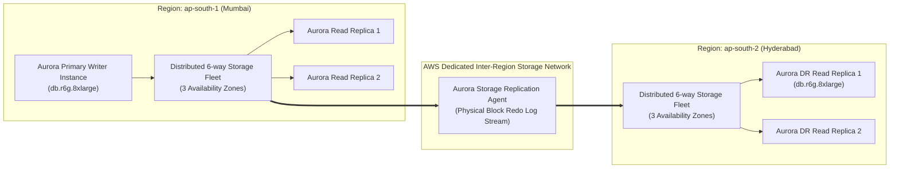
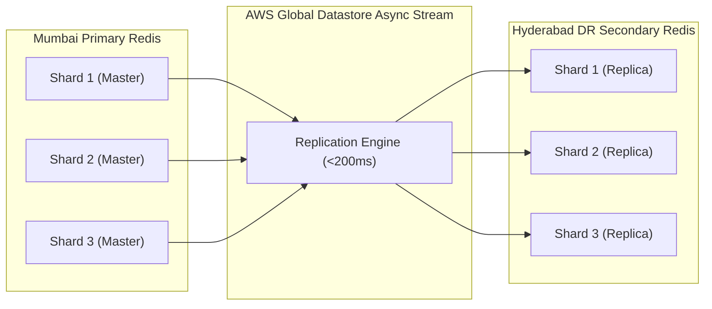
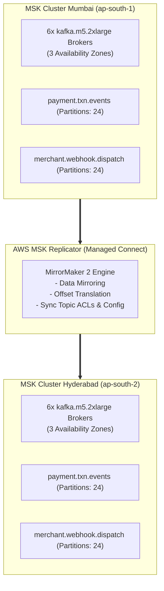
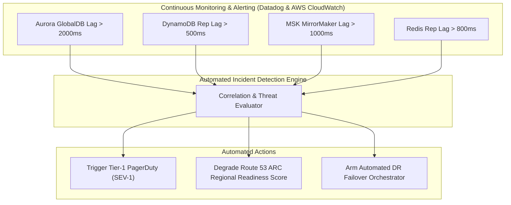

# PaySecure Gateway Private Limited
## Component-Specific Multi-Region Replication & Data Synchronization Strategy
**Target Environment:** AWS `ap-south-1` (Mumbai) & AWS `ap-south-2` (Hyderabad)  
**Document Code:** ARC-COMP-REP-02  
**Classification:** STRICTLY CONFIDENTIAL // TECHNICAL SPECIFICATION  

---

## 1. Executive Matrix of Data Tier Replication

| Storage Technology | Data Workload & Domain | Replication Mechanism | Consistency Model | Typical Cross-Region Replication Lag | Target RPO | Target RTO | Failover Mechanism |
| :--- | :--- | :--- | :--- | :--- | :--- | :--- | :--- |
| **Amazon Aurora PostgreSQL** | Core Double-Entry Ledger, Merchant Balances, Fee Accounts, Settlements | Storage-Level Asynchronous Block Replication (Aurora Global Database) | Primary: Strict ACID.<br/>Secondary: Monotonic Read Consistency. | **400ms – 850ms** | **< 1s (Typ.) / < 5s (Max)** | **< 90s** | AWS RDS Failover / Detach & Promote API via Route 53 ARC |
| **Amazon DynamoDB** | Idempotency Keys, Active Checkout Sessions, Token Vault, Rate Limiter | Managed Multi-Region Active-Active Global Tables (Version 2019.11.21) | Eventual Consistency cross-region; Strong Consistency within regional table. | **80ms – 180ms** | **< 200ms** | **0s (Active-Active)** | Active-Active Client Multi-Endpoint Failover |
| **Amazon ElastiCache Redis** | Merchant Config Cache, Bin Routing Tables, Rate Limits, Temporary Tokens | Redis Global Datastore (Cross-Region Asynchronous Cluster Replication) | Eventual Consistency; Primary cluster in Mumbai, Read Replica in Hyderabad. | **150ms – 300ms** | **< 1s** | **< 60s** | Promote Secondary Cluster to Independent Primary |
| **Apache Kafka (Amazon MSK)** | Payment Events, Webhooks, Risk Analytics Stream, Audit Logs, Notification Queue | AWS MSK Replicator (Managed Kafka Connect / MirrorMaker 2 Engine) | At-least-once cross-cluster replication; Exactly-Once within consumer micro-batches. | **200ms – 450ms** | **< 500ms** | **< 120s** | Dynamic Consumer Group Failover with Offset Translation |

---

## 2. Amazon Aurora PostgreSQL Global Database Replication Strategy

### 2.1 Storage-Level Replication Mechanics
PaySecure utilizes an Aurora Global Database cluster spanning `ap-south-1` (Primary DB cluster `paysecure-aurora-mumbai`) and `ap-south-2` (Secondary DB cluster `paysecure-aurora-hyderabad`).



1. **Storage Tier Bypass:** Replication occurs at the distributed storage layer via dedicated storage nodes; the database engine CPU in Mumbai is completely decoupled from replication work. No logical replication or trigger overhead exists.
2. **Physical Redo Log Streaming:** Redo log records are streamed directly from storage nodes in `ap-south-1` to storage nodes in `ap-south-2`.
3. **Replication Lag Tracking:** Monitored via CloudWatch metric `AuroraGlobalDBReplicationLag`. Alarm triggers if lag exceeds **2,000 milliseconds for 2 consecutive 10-second evaluations**.

### 2.2 Sequence Gap & LSN Management
* **Handling Global Sequence Gaps:** To prevent PostgreSQL sequence collisions during failover, sequences are defined with step allocation or managed using Snowflake IDs generated at the application tier.
  ```sql
  -- Snowflake ID Generation: 64-bit integer
  -- 41 bits timestamp | 10 bits machine/region ID | 12 bits sequence counter
  -- Region ID: Mumbai = 0001, Hyderabad = 0002
  CREATE OR REPLACE FUNCTION generate_paysecure_id(region_id INT DEFAULT 1) RETURNS BIGINT AS $$
  DECLARE
      epoch_ms BIGINT := 1704067200000; -- 2024-01-01
      current_ms BIGINT;
      seq_id INT;
  BEGIN
      current_ms := FLOOR(EXTRACT(EPOCH FROM clock_timestamp()) * 1000) - epoch_ms;
      seq_id := nextval('transaction_id_seq') % 4096;
      RETURN (current_ms << 22) | (region_id << 12) | seq_id;
  END;
  $$ LANGUAGE plpgsql;
  ```
* **Read-After-Write Consistency:** For secondary read queries in Hyderabad during non-failover, the client specifies minimum Log Sequence Number (LSN) tokens to guarantee session consistency.

### 2.3 Planned Switchover vs. Unplanned Failover
* **Planned Switchover (Zero Data Loss):** Initiated via `aws rds switchover-global-cluster`. Secondary cluster synchronizes to current primary LSN; primary transitions to secondary; zero storage loss, total transition time ~40 seconds.
* **Unplanned Failover (Emergency Recovery):** In the event of catastrophic `ap-south-1` failure, the operator or automated orchestrator invokes `aws rds failover-global-cluster --global-cluster-identifier paysecure-global-db --target-db-cluster-identifier-arn <arn-hyd> --allow-data-loss`. Secondary is promoted to a standalone regional cluster in **~65 seconds**.

---

## 3. Amazon DynamoDB Global Tables Strategy

### 3.1 Data Modeling for Idempotency & Checkout Sessions
DynamoDB Global Tables Version 2019.11.21 is deployed across `ap-south-1` and `ap-south-2`.

```json
{
  "PK": "MERCHANT#m_948194",
  "SK": "IDEMPOTENCY#ord_pay_9941a80c4",
  "status": "PROCESSING",
  "created_at_utc": "2026-10-01T06:30:15.120Z",
  "payment_reference_id": "pay_55910283",
  "amount_paisa": 4500000,
  "currency": "INR",
  "origin_region": "ap-south-1",
  "version": 1,
  "ttl": 1759384215
}
```

### 3.2 Conflict Resolution & Idempotency Guarantees
1. **Last-Writer-Wins (LWW):** DynamoDB resolves concurrent updates using internal timestamps. To avoid stale overwrites during multi-region concurrent retries, PaySecure enforces **Conditional Writes**:
   ```python
   # Conditional Put with state machine guard
   table.put_item(
       Item=item,
       ConditionExpression='attribute_not_exists(PK) OR #ver < :new_ver',
       ExpressionAttributeNames={'#ver': 'version'},
       ExpressionAttributeValues={':new_ver': item['version']}
   )
   ```
2. **Partition Key Hashing:** Partition keys combine `MerchantID` and `OrderId` to ensure uniform distribution across all storage partitions in both Mumbai and Hyderabad.
3. **Replication Monitoring:** CloudWatch metric `ReplicationLatency` is alerted at > **500 milliseconds**.

---

## 4. Amazon ElastiCache Redis Replication Strategy

### 4.1 Topology & Global Datastore Configuration
PaySecure uses **Amazon ElastiCache Redis Global Datastore**:
* **Primary Cluster (`paysecure-redis-mum`):** 3-node cluster with 1 primary and 2 in-region read replicas distributed across 3 AZs in `ap-south-1`. Cluster Mode Enabled with 6 shards.
* **Secondary Cluster (`paysecure-redis-hyd`):** Read-only cluster replica hosted in `ap-south-2` continuously synchronizing data via AWS cross-region cluster replication.



### 4.2 Cache-Aside & Thundering Herd Protection
1. **Promotion Procedure:** Upon DR declaration, secondary cluster is promoted via `aws elasticache modify-global-replication-group --global-replication-group-id paysecure-global-redis --automatic-failover-enabled`.
2. **Thundering Herd Shield:**
   * Probabilistic Early Expiration (XFetch algorithm) prevents simultaneous cache misses during traffic rerouting.
   * Distributed Lock with jitter: When cache keys for popular merchant routing rules expire, an atomic Redis lock (`SET lock:merchant_config NX PX 5000`) allows only one container to query Aurora, while other threads sleep for 50ms.

---

## 5. Apache Kafka (Amazon MSK) Dual-Cluster Replication Strategy

### 5.1 Architecture: Active-Active MSK with Offset Translation
PaySecure processes critical asynchronous workflows over Kafka:
* Topics: `payment.txn.created`, `payment.txn.success`, `payment.txn.failed`, `merchant.webhook.dispatch`, `ledger.posting.events`, `risk.scoring.stream`.



### 5.2 Producer & Consumer Guarantees
1. **Producer Reliability Configuration:**
   * `acks = all`: Producer waits for full in-sync replica acknowledgment before reporting success.
   * `min.insync.replicas = 2`: Out of 3 replicas per partition, at least 2 must acknowledge write.
   * `enable.idempotence = true`: Kafka broker guarantees deduplication of messages across producer retries.
2. **Offset Translation & Failover:**
   * MSK Replicator continuously maps consumer group offsets between Mumbai and Hyderabad into topic `__amazon_msk_replicator_offsets`.
   * During failover, consumer groups in Hyderabad query the offset checkpoint topic to resume consuming at the precise translated consumer offset, guaranteeing zero missed events and minimal duplicate processing.
3. **Consumer Idempotency:**
   * All event consumers implement atomic upsert with unique transaction UUID to guarantee idempotent execution even when reprocessing up to 5 seconds of mirrored events.

---

## 6. End-to-End Replication Health & Lag Monitoring


