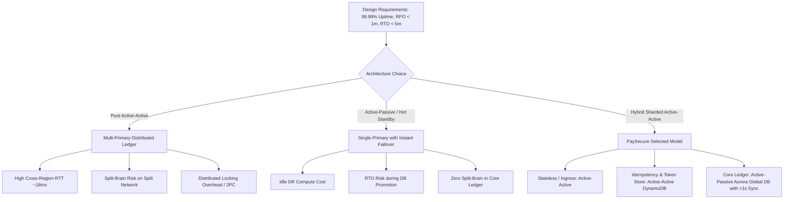
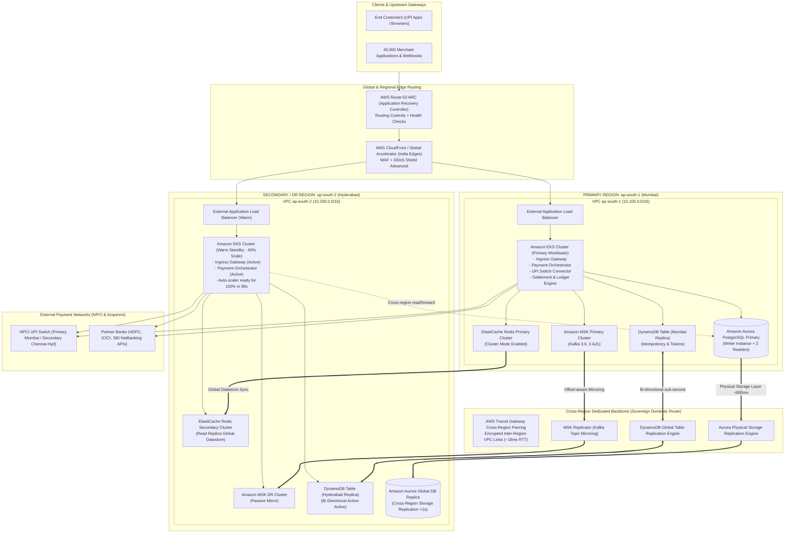
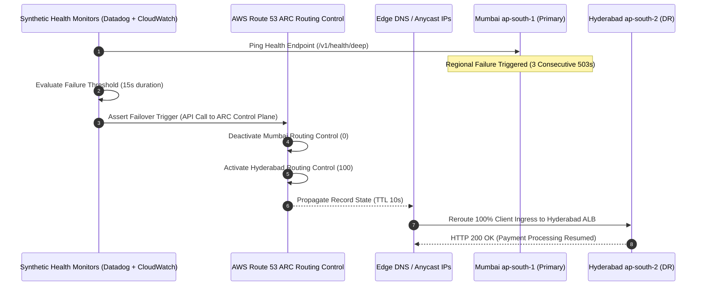

# PaySecure Gateway Private Limited
## Master Disaster Recovery & High-Availability Architecture (v3.4 - Production Baseline)
**Target Operating Date:** Q3 2026  
**Primary Region:** AWS Asia Pacific (Mumbai) — `ap-south-1`  
**Secondary / DR Region:** AWS Asia Pacific (Hyderabad) — `ap-south-2`  
**Classification:** STRICTLY CONFIDENTIAL // INTERNAL USE ONLY  
**Regulatory Frameworks:** RBI Master Directions (Payment Systems & Tech Risk), PCI-DSS v4.0, NPCI UPI Guidelines, DPDP Act 2023  

---

## 1. Executive Summary & Business Context

### 1.1 Company Profile & Operational Scale
**PaySecure Gateway Private Limited** is an RBI-authorized Payment Aggregator (PA) and Payment Gateway (PG) operating in the Indian FinTech and BFSI ecosystem. PaySecure handles payment acceptance, processing, merchant settlement, refunds, and dispute management across cards (RuPay, Visa, Mastercard), UPI (Unified Payments Interface), Net Banking (50+ banks), and tokenized wallets.

| Metric | Current Metric Value | Production Engineering Baseline |
| :--- | :--- | :--- |
| **Daily Transaction Volume** | 3.2 Million transactions/day | ~37.04 Average TPS (Transactions Per Second) |
| **Gross Merchandise Value (GMV)** | ₹500 Crore INR / day (~$60M USD/day) | ₹3.47 Lakhs INR GMV processed per minute |
| **Active Onboarded Merchants** | 45,000+ Enterprise & SMB Merchants | API Webhooks, Real-time checkout SDKs |
| **Peak Transaction Multiplier** | 8x to 12x (during festival sales & flash spikes) | **300 - 450 Peak TPS** (burst headroom to 1,200 TPS) |
| **Current Availability** | 99.92% (Single Region - Mumbai) | Downtime: ~7.01 hours per year |
| **Target Availability (Q3 2026)**| **99.99% (Multi-Region)** | Max Tolerable Downtime: **52.56 minutes/year** |
| **Recovery Point Objective (RPO)**| **< 1 Minute** (Regulatory SLA) | Architecture Target: **< 5 Seconds** |
| **Recovery Time Objective (RTO)**| **< 5 Minutes** (Regulatory SLA) | Architecture Target: **< 3 Minutes** (Automated) |
| **Sovereign Boundary** | Sovereign Territory of India | No data replication or traffic transit outside India |

---

## 2. Problem Statement & Baseline Vulnerability Analysis

### 2.1 The Current Single-Region Reality
Currently, PaySecure runs exclusively in `ap-south-1` (AWS Mumbai) across 3 Availability Zones (AZs). While multi-AZ protects against isolated hardware, rack, or datacenter failures, it leaves PaySecure catastrophically exposed to:
1. **Regional Service Outages:** Outages affecting regional AWS control planes (IAM, Route 53 regional endpoints, KMS, DynamoDB endpoints).
2. **Physical/Natural Catastrophes:** Regional grid disruptions, seismic events, or severe flooding affecting the Mumbai metropolitan belt.
3. **Submarine Cable / Fiber Cuts:** Trans-coastal internet backbone disruption affecting transit to major Indian telecommunications carriers (Jio, Airtel, Tata Communications).
4. **Regulatory Non-Compliance:** RBI Master Direction (Section 8 on Business Continuity) specifically requires payment aggregators of significant systemic importance to maintain geographic separation between Primary and DR sites of at least 250+ kilometers, situated in different seismic zones.

### 2.2 Cost of Downtime Calculus
* **Direct Revenue Loss:** Average MDR of 1.2% on ₹500 Crore daily GMV yields ₹60,00,000 daily fee revenue (~₹4,166 per minute).
* **GMV at Risk:** **₹3,47,222 per minute**. During a 1-hour outage, ₹2.08 Crore in merchant transactions fail.
* **Merchant Churn & SLA Penalties:** Tier-1 enterprise merchants (e-commerce, food delivery, airlines) have automated smart-routing fallbacks that switch to competitor gateways (Razorpay, Cashfree, Pine Labs) after 3 consecutive failures or latency > 2,500ms. A 10-minute outage causes permanent loss of 15% transaction volume for 72 hours.
* **Regulatory Fines:** Under Section 30 of the Payment and Settlement Systems Act, 2007, RBI reserves the right to impose punitive penalties up to ₹5 Crore and cancel aggregator operating licenses for recurring availability lapses.

---

## 3. Architecture Paradigm Evaluation: Active-Active vs. Active-Passive

A critical engineering decision for PaySecure is choosing between **Active-Active (Bi-Directional Multi-Region)** and **Active-Passive (Hot Standby / Warm Standby with Automated Failover)** across `ap-south-1` (Mumbai) and `ap-south-2` (Hyderabad).

### 3.1 Trade-off Matrix

| Evaluation Dimension | Pure Active-Active (Multi-Master) | Active-Passive (Hot Standby) | Hybrid Sharded Active-Active (Chosen) |
| :--- | :--- | :--- | :--- |
| **Financial Ledger Consistency** | **Extremely Complex:** Requires 2-Phase Commit (2PC) or Raft/Paxos across ~18ms RTT, introducing 40-70ms transaction latency, unacceptable for UPI 2-second timeout SLA. | **Strong Consistency:** Single primary writer guarantees strict ACID properties, zero risk of double-spending or ledger divergence. | **Optimal:** Ingress, tokenization, and auth are active-active. Core double-entry ledger is single-primary with storage-level asynchronous replication (<1s lag). |
| **RPO Achieved** | 0 seconds | 1 - 5 seconds (Storage sync lag) | **< 1 second** |
| **RTO Achieved** | 0 seconds | 2 - 4 minutes (Promote & DNS switch) | **< 2 minutes** (Automated Route 53 ARC + Aurora promote) |
| **Split-Brain Risk** | **High:** Network partition between regions could cause both to process conflicting state unless strict quorum is preserved. | **Low:** Single writer; secondary promotes only upon cryptographically verified quorum trigger. | **Mitigated:** Route 53 ARC 5-region consensus control plane prevents dual primaries. |
| **Replication Overhead** | Continuous bi-directional conflict resolution (CRDT / Last-Write-Wins), risk of silent ledger divergence. | Uni-directional block-level storage replication inside AWS physical backbone. | Asynchronous storage replication at hypervisor tier; zero application CPU overhead. |
| **Infrastructure Cost Ratio** | 2.1x baseline | 1.4x baseline (Pilot compute scale) | **1.65x baseline** (Balanced sizing & autoscaling) |

### 3.2 Selected Architecture: Hybrid Sharded Active-Active & Warm Core
PaySecure selects the **Hybrid Sharded Active-Active & Warm Core** model:
1. **Tier 1 (Edge & Stateless Ingress):** **Active-Active** across Mumbai and Hyderabad. DNS routing via AWS Route 53 Application Recovery Controller (ARC) with latency-based routing under normal operations.
2. **Tier 2 (Tokenization & Idempotency Store):** **Active-Active** using **Amazon DynamoDB Global Tables** across `ap-south-1` and `ap-south-2` with sub-second bi-directional replication.
3. **Tier 3 (Core Double-Entry Transaction Ledger):** **Active-Passive (Hot Standby)** using **Amazon Aurora PostgreSQL Global Database**. Primary writer in `ap-south-1`, read replica in `ap-south-2` with typical physical storage replication lag under 800 milliseconds.
4. **Tier 4 (Asynchronous Processing & Event Sourcing):** **Dual-Cluster Apache Kafka (AWS MSK)** interconnected via **AWS MSK Replicator** with deterministic consumer offset translation.

---

## 4. Complete End-to-End System Architecture

### 4.1 Topology Diagram

---

## 5. Network Architecture & Inter-Region Connectivity

### 5.1 Subnetting & IP Scheme
To prevent IP overlap and enable seamless cross-region VPC peering and Transit Gateway attachments, the following CIDR allocations are strictly enforced:

| VPC / Purpose | Region | CIDR Block | Subnets & Availability Zones |
| :--- | :--- | :--- | :--- |
| **Primary Production VPC** | `ap-south-1` (Mumbai) | `10.100.0.0/16` | Public: `10.100.0.0/20` (AZ-a,b,c) Private App: `10.100.32.0/19` Secure Data: `10.100.64.0/19` |
| **Secondary DR VPC** | `ap-south-2` (Hyderabad) | `10.200.0.0/16` | Public: `10.200.0.0/20` (AZ-a,b,c) Private App: `10.200.32.0/19` Secure Data: `10.200.64.0/19` |
| **Core Shared Services / Ops** | `ap-south-1` | `10.101.0.0/16` | CI/CD, Bastion, Monitoring, Vault |
| **DR Shared Services / Ops** | `ap-south-2` | `10.201.0.0/16` | DR CI/CD, DR Monitoring, Vault Replica |

### 5.2 Inter-Region Transit Gateway (TGW) & MTU
* Dual AWS Transit Gateways are established in `ap-south-1` and `ap-south-2` interconnected via an **Inter-Region Transit Gateway Peering Attachment** traversing the AWS dedicated physical backbone.
* **Network MTU:** Configured for **8,500 Jumbo Frames** across the inter-region peering link to maximize Kafka and database replication throughput while minimizing packet fragmentation.
* **Latency Profile:** Observed Round-Trip Time (RTT) between AWS Mumbai and AWS Hyderabad data centers averages **16.8ms to 19.4ms** with jitter under 0.8ms.
* **Encryption in Transit:** All traffic crossing the inter-region backbone is encrypted at the physical layer (MACsec IEEE 802.1AE) by AWS, and additionally encrypted at the transport layer using TLS 1.3 with PFS (Perfect Forward Secrecy) enforced by PaySecure mutual-TLS service meshes.

---

## 6. Route 53 Application Recovery Controller (ARC) Traffic Management

### 6.1 Routing Architecture & Health Checks
PaySecure utilizes **AWS Route 53 Application Recovery Controller (ARC)** routing controls rather than simple DNS TTL failover:
1. **ARC Multi-Region Quorum Control Plane:** Unlike standard regional control planes, Route 53 ARC maintains an active control plane replicated across five independent AWS regions globally, ensuring routing controls can be flipped even if `ap-south-1` is completely unreachable.
2. **Failover Execution Time:** DNS TTL is set to **10 seconds**. With ARC routing controls toggled via the ARC API or AWS CLI, 100% of global traffic ingress migrates to Hyderabad in **< 45 seconds**.
3. **Zonal & Regional Readiness Checks:** ARC readiness checks continuously audit whether Hyderabad has sufficient capacity, replica sync status, and warm compute allocations before allowing traffic cutover.

---

## 7. Security, Encryption & Key Management Architecture

### 7.1 Multi-Region KMS Architecture (`mrk-`)
In compliance with PCI-DSS v4.0 Requirement 3.5, 3.6, and 3.7:
* PaySecure implements **AWS KMS Multi-Region Keys**. Primary multi-region symmetric encryption keys are created in `ap-south-1` and replicated to `ap-south-2` with identical Key IDs and key material.
* **Key ID Format:** `arn:aws:kms:ap-south-1:112233445566:key/mrk-847291a0c4f84d6fb30b` has replica `arn:aws:kms:ap-south-2:112233445566:key/mrk-847291a0c4f84d6fb30b`.
* **Zero Cross-Region Decryption Dependency:** Hyderabad workloads decrypt cardholder token stores and PAN envelopes locally within `ap-south-2` without needing cross-region KMS API calls to Mumbai.
* **Automatic Key Rotation:** Configured for automated annual rotation; key material rotation propagates across both regions synchronously.

### 7.2 AWS Secrets Manager & IAM Federation
* **Cross-Region Secret Replication:** Database credentials, merchant webhook signing secrets, and third-party bank API private keys are stored in AWS Secrets Manager in Mumbai and automatically replicated to Hyderabad using native Secret Replication.
* **IAM Role Parity:** EKS Service Accounts (IRSA - IAM Roles for Service Accounts) and IAM policies are synchronized via GitOps (Terraform + ArgoCD) with identical permissions boundaries across both regions.
* **Audit Trail Immutability (PCI-DSS Req 10):** CloudTrail, VPC Flow Logs, and Application Audit Logs are streamed to a dedicated security account bucket equipped with **AWS S3 Object Lock in Compliance Mode** (7-year retention), replicated across Mumbai and Hyderabad.

---

## 8. Financial Ledger Idempotency & Reconciliation Engine

### 8.1 The Financial Integrity Challenge
In payment processing, failover must never cause:
* **Double Deductions:** Debiting a customer bank account twice for one cart purchase.
* **Phantom Credits:** Crediting merchant escrow without settling with acquiring bank.
* **Lost Payment Status:** Failing to record an incoming bank webhook notification.

### 8.2 Three-Tier Idempotency Architecture
1. **Edge Idempotency Key (DynamoDB Global Table):**
   * Every merchant API call supplies `X-Idempotency-Key` (UUIDv4 or merchant order ID).
   * DynamoDB stores `{ partition_key: "merchant_id#idempotency_key", status: "IN_FLIGHT" | "SUCCESS" | "FAILED", response_payload, ttl: 86400 }`.
   * Written with conditional expressions (`attribute_not_exists(pk)`).
   * Replicated between Mumbai and Hyderabad in <200ms. If a merchant retries during regional failover, Hyderabad rejects duplicate requests immediately.
2. **Double-Entry Financial Ledger (Aurora PostgreSQL):**
   * Immutable accounting model: Ledger entries are append-only.
   * Debits must equal credits across ledger accounts:
     * Customer Settlement Account
     * Merchant Payable Account
     * PaySecure Fee Revenue Account
     * GST Liability Account
     * Bank Clearing / Escrow Account
3. **Post-Failover Automated Reconciliation Engine (`dr-recon-tool`):**
   * Detailed script executing upon secondary promotion:
     - Scans Kafka high-water marks and uncommitted consumer group offsets.
     - Compares Aurora Global Database Log Sequence Number (LSN) with DynamoDB idempotency logs.
     - Queries NPCI UPI switch reconciliation endpoints (`UPI-UDIR` and `UPI-REQ-CHK-TXN`) to ascertain true settlement status for any transaction in transit during failover.

---

## 9. Cost Optimization & Capacity Planning

### 9.1 Sizing Philosophy: Pilot Light Compute + Hot Storage
Running 100% full duplicate capacity in Hyderabad would increase infrastructure costs by 95-100%. PaySecure leverages a **Warm Compute + Hot Data** strategy:

| Component | Mumbai Capacity (Primary) | Hyderabad Capacity (DR - Standby) | Post-Failover Autoscaling Target |
| :--- | :--- | :--- | :--- |
| **Amazon EKS (Nodes)** | 24x `c6i.4xlarge` (384 vCPU, 768 GB) | 10x `c6i.4xlarge` (160 vCPU, 320 GB) | Scaled to 28x nodes via Karpenter in **90 seconds** |
| **Aurora PostgreSQL** | 1x `db.r6g.8xlarge` Writer 2x `db.r6g.8xlarge` Readers | 1x `db.r6g.8xlarge` Global Replica 1x `db.r6g.8xlarge` Reader | Promoted to Writer in **< 90 seconds** |
| **Amazon MSK Kafka** | 6x `kafka.m5.2xlarge` brokers | 6x `kafka.m5.2xlarge` brokers (Matched) | Instant failover (Zero re-provisioning lag) |
| **DynamoDB Global** | On-Demand Auto-Scaling | On-Demand Auto-Scaling | Instantaneous scaling |
| **ElastiCache Redis** | 3-node cluster `cache.r6g.2xlarge` | 3-node Global Datastore replica | Promoted to standalone primary in **< 60 seconds** |

### 9.2 Financial Cost Analysis
* **Current Monthly Single-Region Infrastructure Spend:** ₹38,50,000 INR (~$46,000 USD)
* **Projected Multi-Region Infrastructure Spend:** ₹63,52,500 INR (~$76,000 USD) — an increment of **₹25,02,500 INR / month (65% increase)**.
* **Return on Investment (ROI):** 
  - Preventing a single 2-hour regional failure saves **₹4.16 Crore in direct GMV fallout**, merchant recovery costs of ~₹1.2 Crore, and avoids regulatory penalties up to ₹5 Crore.
  - Payback period of the DR architecture is demonstrated upon preventing a single major outage.
