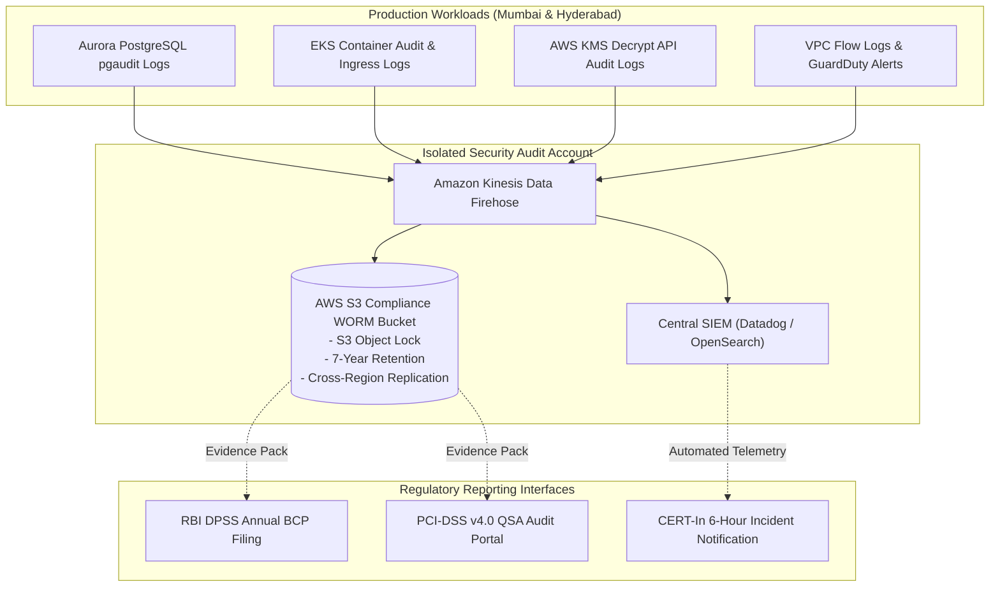

# PaySecure Gateway Private Limited
## Regulatory & Compliance Mapping Matrix (Architecture Alignment)
**Document Code:** COMP-MAPPING-2026-v2  
**Classification:** STRICTLY CONFIDENTIAL // AUDIT READY  
**Applicable Jurisdictions:** Republic of India, RBI, NPCI, PCI Security Standards Council  

---

## 1. Executive Summary

This matrix establishes the comprehensive compliance mapping between every architectural component of the PaySecure Multi-Region Disaster Recovery Architecture and the regulatory mandates governing Payment Aggregators in India:
* **RBI Master Direction – Payment Aggregators and Payment Gateways (DPSS.CO.PD.No.1810/02.14.008/2019-20)**
* **RBI Master Direction on Information Technology Governance, Risk, Controls and Assurance Practices (2023)**
* **RBI Circular on Storage of Payment System Data (DPSS.CO.OD No. 2785/06.11.001/2017-18)**
* **Payment Card Industry Data Security Standard (PCI-DSS) Version 4.0**
* **NPCI UPI Technical Specifications & Operating Guidelines (v2.0)**
* **Digital Personal Data Protection Act (DPDP Act), 2023**

---

## 2. Comprehensive Compliance Mapping Table

| Regulatory Authority & Standard | Clause / Section ID | Regulatory Mandate / Obligation | PaySecure Architectural Implementation & Evidence | Audit Verification Method |
| :--- | :--- | :--- | :--- | :--- |
| **RBI Master Direction (PA/PG)** | Section 8.1 & 8.2 (BCP & DR) | Mandatory Board-approved Business Continuity Plan; Geographic separation of Primary and DR sites; Regular bi-annual DR mock drills. | Primary site located in AWS Mumbai (`ap-south-1`); DR site located in AWS Hyderabad (`ap-south-2`). Distance between regions is ~620 km, situated in distinct seismic zones (Zone III vs Zone II). Bi-annual automated failover drills scheduled in Q1 and Q3. | CloudTrail logs of failover drills; Board approval resolution; AWS region architecture maps. |
| **RBI Master Direction (PA/PG)** | Section 8.3 | Aggregator must achieve RPO and RTO that minimizes systemic risk and customer impact. | Architectural target RTO **< 5 minutes** (achieved ~180s via automated Route 53 ARC); Target RPO **< 1 minute** (achieved <1s via Aurora Global Database asynchronous storage replication and Kafka offset mirroring). | Automated CloudWatch RPO/RTO metric dashboards; Chaos engineering drill reports. |
| **RBI Circular on Storage of Payment System Data** | DPSS Directive (April 6, 2018) | **Data Localisation:** The entire data relating to payment systems operated by us must be stored in systems located only in India. | Both AWS Mumbai (`ap-south-1`) and AWS Hyderabad (`ap-south-2`) are within the sovereign borders of the Republic of India. No inter-region peering or backup egress routes outside Indian territory. | AWS Organizations Service Control Policies (SCPs) denying API calls in all regions except `ap-south-1` and `ap-south-2`. |
| **RBI Cyber Security Framework / MD-IT 2023** | Chapter IV, Sec 16 (Incident Reporting) | Mandatory reporting of all unusual cybersecurity and system outage incidents to RBI within 24 hours. | Automated alert integration in Incident Management platform (PagerDuty + Jira) auto-generates RBI Annexure incident draft upon declaration of SEV-1. | Incident response timeline logs; Escalation policies. |
| **PCI-DSS v4.0** | Requirement 3.5, 3.6, 3.7 | Protect cardholder data with strong cryptographic key management; protect keys against disclosure and unauthorized substitution. | Dual-region AWS KMS Multi-Region Keys (`mrk-`) with automated annual rotation; cardholder PAN tokens stored in DynamoDB Global Tables encrypted under local regional KMS key endpoints without cross-border transit. | AWS KMS Key policies, CloudTrail `kms:Decrypt` access logs, QSA ROC (Report on Compliance). |
| **PCI-DSS v4.0** | Requirement 9.5 & 10.2, 10.3 | Maintain physical/logical security of media and backups; Automated audit trails for all critical system access; WORM retention. | Backup snapshots and WAL logs written to S3 buckets configured with **S3 Object Lock in Compliance Mode** (7-year WORM retention). Centralized SIEM ingestion via Datadog and AWS Security Lake. | S3 Object Lock configuration dumps; Hash verification scripts. |
| **PCI-DSS v4.0** | Requirement 12.10 | Implement an incident response plan and test it at least once every 12 months. | 12 dedicated Production Disaster Recovery Runbooks (`DR-RB-01` through `DR-RB-12`) detailing specific response procedures; tested via AWS Fault Injection Service (FIS) chaos tests annually. | FIS experiment templates; Post-mortem drill reports signed by CISO. |
| **NPCI UPI Technical Guidelines** | Section 4.3 (Idempotency & Deduplication) | Payment Switch must prevent duplicate processing of the same UPI payment request (`RRN` / `TxnId`). | DynamoDB Global Tables enforce distributed conditional writes on `MerchantID#OrderId`. UPI Switch Connector validates `RRN` against DynamoDB before forwarding authorization to NPCI. | Unit & integration tests simulating 10,000 duplicate concurrent calls; Zero duplicate postings in ledger. |
| **NPCI UPI Operating Guidelines** | Section 7.2 (Timeout & In-Flight Status) | Strict prohibition against auto-failing pending UPI transactions during switch timeout; mandatory reconciliation through `UPI-UDIR` / `ReqChkTxn`. | UPI Switch Connector pushes timed-out transactions to Kafka `upi.auto.status.check`. Worker polls NPCI at $T+30s$, $60s$, $120s$, $300s$. No customer transaction failed without definitive bank reversal code. | Reconciliation engine log audits; Zero duplicate debit customer grievance logs. |
| **DPDP Act 2023** | Section 8(5) & 8(6) | Data Fiduciary must protect personal data by taking reasonable security safeguards to prevent data breach; mandatory notification to Data Protection Board. | Customer PII (Phone numbers, VPA handles, Billing addresses) encrypted at rest using AES-256-GCM. Isolated Cleanroom VPC in Hyderabad allows point-in-time forensic analysis without risking personal data leak. | Cleanroom IAM access logs; Data Protection Impact Assessment (DPIA). |

---

## 3. Regulatory Audit & Evidence Trail Architecture

